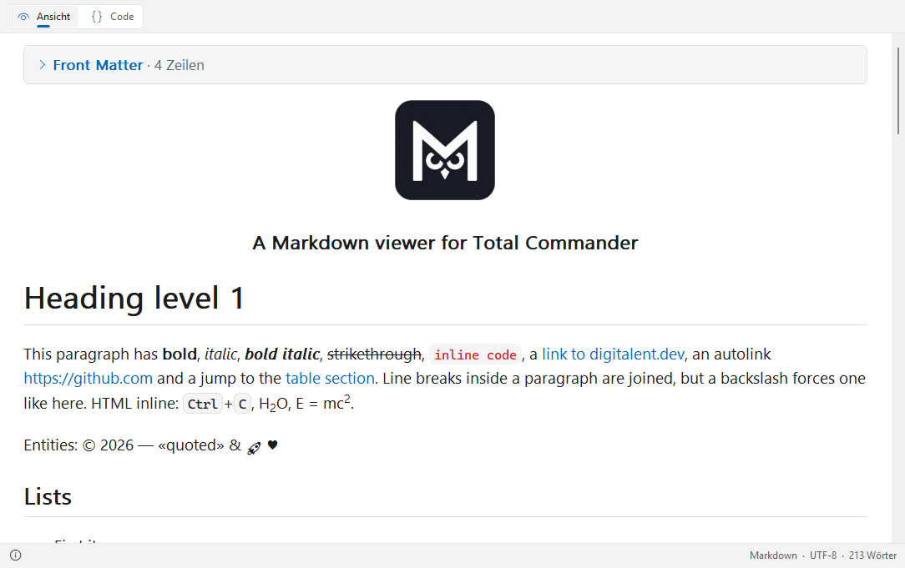

# MowlView

[English](README.md) | **Deutsch**

Ein Markdown-Betrachter (Lister-Plugin) für den [Total Commander](https://www.ghisler.com), 32 und 64 Bit.
F3 auf einer Markdown-Datei zeigt sie so, wie sie gemeint ist – mit Überschriften, Tabellen, Code, Bildern und Links – oder mit einem Klick als Quelltext mit Syntaxhervorhebung.
Nativ und schnell: keine Browser-Engine, keine Laufzeitumgebung, nichts zu installieren außer dem Plugin.

## Unterstützte Dateien

- **Markdown:** `.md`, `.markdown`, `.mdown`, `.mkd`, `.mkdn`, `.mdwn`, `.mdtxt`, `.mdtext`, `.mdx`, `.livemd`
- **R Markdown und Quarto:** `.rmd`, `.qmd` – YAML-Front-Matter als aufklappbarer Kasten
- **Jupyter-Notebooks:** `.ipynb` – Markdown-Zellen, Codezellen mit Ausführungsnummer, Text- und Bildausgaben
- **Gemini-Gemtext:** `.gmi`, `.gemini`

## Funktionen

- CommonMark mit den GitHub-Erweiterungen: Tabellen, Aufgabenlisten, Durchstreichen, Autolinks, Fußnoten und Hinweisboxen (NOTE, TIP, IMPORTANT, WARNING, CAUTION)
- Inline-HTML und HTML-Blöcke: `kbd`, `sub`, `sup`, zentrierte Bilder und aufklappbare `details`-Abschnitte
- Syntaxhervorhebung in Codeblöcken (C/C++, C#, Java, JavaScript/TypeScript, Python, Rust, Go, JSON, diff und viele mehr)
- Flussdiagramme: Mermaid-Diagramme (`flowchart` / `graph`) in `mermaid`-Codeblöcken werden als Bild gezeichnet – alle Richtungen, Knotenformen, Linienarten, Beschriftungen, Untergruppen, `style` und `classDef`
- Bilder aus lokalen Dateien: PNG, JPEG, GIF, BMP, TIFF, ICO (WebP/HEIC mit den Windows-Codecs), in hoher Qualität skaliert
- Text von rechts nach links (Arabisch, Hebräisch, Persisch) wird pro Absatz erkannt und bekommt eine eigene Schrift
- Klickbare Links: Sprünge im Dokument, andere Dateien und Webadressen; *Gehe zu Überschrift* im Kontextmenü; Überschriften akzeptieren eine eigene ID (`## Titel {#meine-id}` oder `## Titel (#meine-id)`)
- Textcursor: mit Strg+K oder einem Klick in den Text einschalten, mit Pfeiltasten, Pos1/Ende und Strg+Pfeil bewegen, mit Umschalt markieren
- Wählbare Schriftarten für Text, Text von rechts nach links und Code
- Helles und dunkles Design: automatisch wie Windows, wie Total Commander oder fest – im Windows-11-Look
- Knöpfe oben, in der Statusleiste oder ausgeblendet (*Knöpfe* im Kontextmenü)
- Statusleiste mit Format, Kodierung und Wort- bzw. Zeilenzahl
- Kodierungen: UTF-8, UTF-16 (mit oder ohne BOM), Windows-1252
- Oberfläche auf Deutsch und Englisch (richtet sich nach der Windows-Sprache)

## Download und Installation

1. **`MowlView.zip`** aus der [neuesten Version](https://github.com/naderi/tc-mowlview/releases/latest) herunterladen.
2. Die ZIP-Datei im Total Commander öffnen (Enter auf der Datei) und die Frage nach der Installation des Plugins bestätigen.

Die Einstellungen liegen in `MowlView.ini` neben dem Plugin.

## Tasten

| Taste | Aktion |
|---|---|
| Strg+1 / Strg+2 | *Ansicht* / *Code* |
| Strg+W | *Zeilenumbruch* (in *Code*) |
| Strg+Plus / Strg+Minus / Strg+0 | *Vergrößern* / *Verkleinern* / *Zoom zurücksetzen* (auch Strg+Mausrad) |
| Strg+A, Strg+C | *Alles markieren*, *Kopieren* |
| F7 | Suchen (Suche des Total Commander) |
| F1 | Info |

Weitere Optionen – *Design*, *Knöpfe*, *Schriftart*, *Gehe zu Überschrift* – stehen im Kontextmenü (Rechtsklick).

## Lizenz

Freeware – kostenlos nutzbar, aber **nicht verkäuflich**. Siehe [LICENSE](LICENSE).

## Unterstützung

Wenn MowlView dir Zeit spart, kannst du die Entwicklung auf Ko‑fi unterstützen. ☕

---

© 2026 [Ali Naderi](https://github.com/naderi) · [digitalent.dev](https://digitalent.dev/de/)
