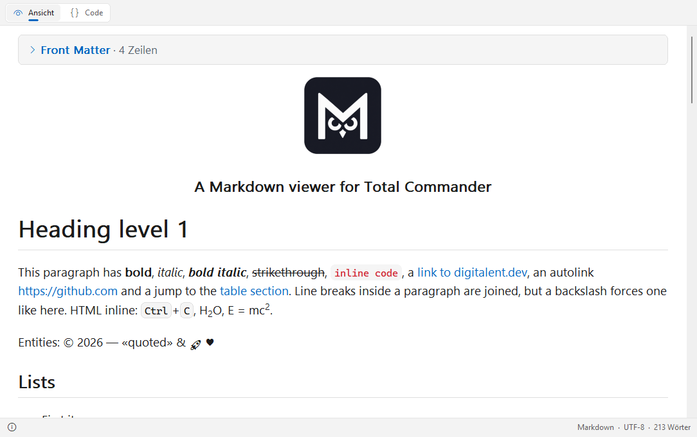

# MowlView

[English](README.md) | **Deutsch**

Ein Markdown-Betrachter (Lister-Plugin) für den [Total Commander](https://www.ghisler.com), 32 und 64 Bit.
F3 auf einer Markdown-Datei zeigt sie so, wie sie gemeint ist – mit Überschriften, Tabellen, Code, Bildern und Links – oder mit einem Klick als Quelltext mit Syntaxhervorhebung.
Nativ und schnell: keine Browser-Engine, keine Laufzeitumgebung, nichts zu installieren außer dem Plugin.

## Unterstützte Dateien

- **Markdown:** `.md`, `.markdown`, `.mdown`, `.mkd`, `.mkdn`, `.mdwn`, `.mdtxt`, `.mdtext`, `.mdx`, `.livemd`
- **R Markdown und Quarto:** `.rmd`, `.qmd` – YAML-Front-Matter als aufklappbarer Kasten
- **Jupyter-Notebooks:** `.ipynb` – Markdown-Zellen, Codezellen mit Ausführungsnummer, Text- und Bildausgaben
- **Gemini-Gemtext:** `.gmi`, `.gemini`

## Funktionen

- CommonMark mit den GitHub-Erweiterungen: Tabellen, Aufgabenlisten, Durchstreichen, Autolinks, Fußnoten und Hinweisboxen (NOTE, TIP, IMPORTANT, WARNING, CAUTION)
- Inline-HTML und HTML-Blöcke: `kbd`, `sub`, `sup`, zentrierte Bilder und aufklappbare `details`-Abschnitte
- Syntaxhervorhebung in Codeblöcken (C/C++, C#, Java, JavaScript/TypeScript, Python, Rust, Go, JSON, diff und viele mehr)
- Diagramme: Mermaid in `mermaid`-Codeblöcken wird als Bild gezeichnet – Flussdiagramme (alle Richtungen, Knotenformen, Linienarten, Beschriftungen, Untergruppen, `style` und `classDef`), Sequenz-, Klassen-, Zustands-, Entity-Relationship-, Gantt-, Timeline-, Git-Graph-, Mindmap- und Kreisdiagramme
- Bilder aus lokalen Dateien: PNG, JPEG, GIF, BMP, TIFF, ICO (WebP/HEIC mit den Windows-Codecs), in hoher Qualität skaliert
- Bilder aus dem Internet (`https`): standardmäßig aus, mit dem Schalter *Bilder aus dem Internet* in der Ansicht einschaltbar – bis dahin steht ein Platzhalter mit dem Alternativtext da; SVG-Bilder wie Badges werden ebenfalls gezeichnet; die Einstellung wird gespeichert
- Text von rechts nach links (Arabisch, Hebräisch, Persisch) wird pro Absatz erkannt und bekommt eine eigene Schrift
- Klickbare Links: Sprünge im Dokument, andere Dateien und Webadressen; *Gehe zu Überschrift* im Kontextmenü; Link- und Bild-Titel (`[Text](url "Titel")`, ``) erscheinen als Tooltip; Überschriften akzeptieren eine eigene ID (`## Titel {#meine-id}` oder `## Titel (#meine-id)`)
- Textcursor: mit Strg+K oder einem Klick in den Text einschalten, mit Pfeiltasten, Pos1/Ende und Strg+Pfeil bewegen, mit Umschalt markieren
- Wählbare Schriftarten für Text, Text von rechts nach links und Code
- Code-Ansicht: Zeilen von rechts nach links werden korrekt dargestellt und markiert; optionale Knöpfe für links- bzw. rechtsbündige Ausrichtung (Kontextmenü → *Ausrichtungsknöpfe (Code)*)
- Helles und dunkles Design: automatisch wie Windows, wie Total Commander oder fest – im Windows-11-Look
- Farbschemen: 24 mitgeliefert (Catppuccin, Gruvbox, Solarized, Tokyo Night, One, GitHub u. a.) im Ordner `Themes`, im Format der VS-Code-Farbthemen; Kontextmenü → Farbschema wählt eines für Hell und eines für Dunkel, eigene Dateien werden ebenfalls erkannt
- Knöpfe oben, in der Statusleiste oder ausgeblendet (*Knöpfe* im Kontextmenü)
- Statusleiste mit Format, Kodierung und Wort- bzw. Zeilenzahl
- Drucken (Datei > Drucken): das gezeigte Dokument (in der Quelltext-Ansicht der Quelltext) auf weißem Papier in Druckgröße, Seitenumbrüche zwischen den Zeilen, mit Seitenzahlen; Papier standardmäßig A4 (das gewählte Papier wird gemerkt, `PaperSize` in `MowlView.ini`: 9 = A4, 1 = Letter); Ränder aus den Druckeinstellungen von Total Commander, oder `PrintMargins` in `MowlView.ini` (mm, ein Wert oder links,oben,rechts,unten), um sie zu überschreiben; `PrintPageNumbers=0` schaltet die Seitenzahlen aus
- Kodierungen: UTF-8, UTF-16 (mit oder ohne BOM), Windows-1252
- Oberfläche auf Deutsch und Englisch (richtet sich nach der Windows-Sprache)

## Download und Installation

1. **`MowlView.zip`** aus der [neuesten Version](https://github.com/naderi/tc-mowlview/releases/latest) herunterladen.
2. Die ZIP-Datei im Total Commander öffnen (Enter auf der Datei) und die Frage nach der Installation des Plugins bestätigen.

Die Einstellungen liegen in `MowlView.ini` neben dem Plugin.

## Tasten

| Taste | Aktion |
|---|---|
| Strg+1 / Strg+2 | *Ansicht* / *Code* |
| Strg+W | *Zeilenumbruch* (in *Code*) |
| Strg+Plus / Strg+Minus / Strg+0 | *Vergrößern* / *Verkleinern* / *Zoom zurücksetzen* (auch Strg+Mausrad) |
| Strg+A, Strg+C | *Alles markieren*, *Kopieren* |
| F7 | Suchen (Suche des Total Commander) |
| F1 | Info |

Weitere Optionen – *Design*, *Knöpfe*, *Schriftart*, *Gehe zu Überschrift* – stehen im Kontextmenü (Rechtsklick).

## Sprachen

MowlView gibt es auf Englisch, Deutsch, Spanisch, Französisch, Russisch, Ukrainisch, Chinesisch (vereinfacht), Hindi, Portugiesisch und Persisch. Es folgt der Windows-Anzeigesprache; eine andere Sprache wählst du über das Rechtsklick-Menü (*Sprache der Oberfläche*) oder mit `Language=<Name oder Kürzel>` in der `MowlView.ini` (zum Beispiel `Persian` oder `fa`; `auto` folgt Windows, `tc` der Sprache von Total Commander – auch als Eintrag *Wie Total Commander*).

Die Texte stehen in einfachen `.lng`-Dateien im Ordner `Languages`. Für eine neue Sprache kopierst du `Languages\Template.lng`, übersetzt die rechten Seiten und speicherst sie unter einem neuen Namen – sie erscheint dann in der Sprachliste.

Korrekturen und neue Übersetzungen von Muttersprachlern sind sehr willkommen – schick sie bitte als [Issue](https://github.com/naderi/tc-mowlview/issues) in diesem Repository.

## Lizenz

Freeware – kostenlos nutzbar, aber **nicht verkäuflich**. Siehe [LICENSE](LICENSE).

## Unterstützung

Wenn MowlView dir Zeit spart, kannst du die Entwicklung auf Ko‑fi unterstützen. ☕

---

© 2026 [Ali Naderi](https://github.com/naderi) · [digitalent.dev](https://digitalent.dev/de/)
