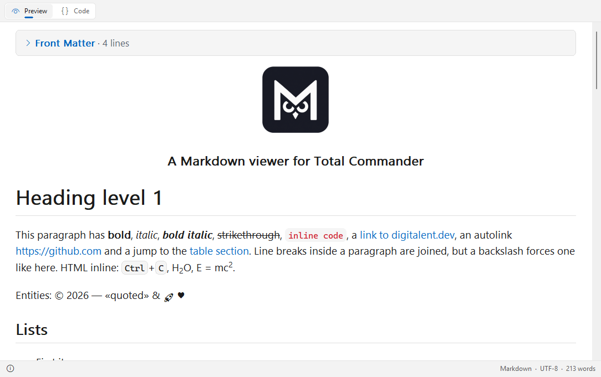

# MowlView

**English** | [Deutsch](README.de.md)

A Markdown viewer (Lister plugin) for [Total Commander](https://www.ghisler.com), 32 and 64 bit.
Press F3 on a Markdown file and see it the way it is meant to look – with headings, tables, code, images and links – or, with one click, as source code with syntax highlighting.
Native and fast: no browser engine, no runtime, nothing to install besides the plugin.

## Supported files

- **Markdown:** `.md`, `.markdown`, `.mdown`, `.mkd`, `.mkdn`, `.mdwn`, `.mdtxt`, `.mdtext`, `.mdx`, `.livemd`
- **R Markdown and Quarto:** `.rmd`, `.qmd` – YAML front matter as a collapsible box
- **Jupyter notebooks:** `.ipynb` – Markdown cells, code cells with execution count, text and image outputs
- **Gemini Gemtext:** `.gmi`, `.gemini`

## Features

- CommonMark with the GitHub extensions: tables, task lists, strikethrough, autolinks, footnotes and alerts (NOTE, TIP, IMPORTANT, WARNING, CAUTION)
- Inline HTML and HTML blocks: `kbd`, `sub`, `sup`, centred images and collapsible `details` sections
- Syntax highlighting in code blocks (C/C++, C#, Java, JavaScript/TypeScript, Python, Rust, Go, JSON, diff and many more)
- Flowcharts: Mermaid `flowchart` / `graph` diagrams in `mermaid` code blocks are drawn as pictures – all directions, node shapes, line styles, labels, subgraphs, `style` and `classDef`
- Pictures from local files: PNG, JPEG, GIF, BMP, TIFF, ICO (WebP/HEIC with the Windows codecs), scaled in high quality
- Right-to-left text (Arabic, Hebrew, Persian) is detected per paragraph and gets its own font
- Clickable links: jumps within the document, other files and web addresses; *Go to heading* in the context menu
- Selectable fonts for text, right-to-left text and code
- Light and dark design: automatic like Windows, like Total Commander, or fixed – in the Windows 11 look
- Buttons at the top, in the status bar or hidden (*Buttons* in the context menu)
- Status bar with format, encoding and word or line count
- Text encodings: UTF-8, UTF-16 (with or without BOM), Windows-1252
- English and German user interface (follows the Windows language)

## Download and installation

1. Download **`MowlView.zip`** from the [latest release](https://github.com/naderi/tc-mowlview/releases/latest).
2. Open the ZIP in Total Commander (Enter on the file) and confirm the question whether to install the plugin.

Settings are stored in `MowlView.ini` next to the plugin.

## Keys

| Key | Action |
|---|---|
| Ctrl+1 / Ctrl+2 | *Preview* / *Code* |
| Ctrl+W | *Word wrap* (in *Code*) |
| Ctrl+plus / Ctrl+minus / Ctrl+0 | Zoom in / out / reset (also Ctrl+mouse wheel) |
| Ctrl+A, Ctrl+C | Select all, copy |
| F7 | Find (Total Commander's search) |
| F1 | About |

More options – *Theme*, *Buttons*, *Font*, *Go to heading* – are in the context menu (right click).

## License

Freeware – free to use, but **not for sale**. See [LICENSE](LICENSE).

## Support

If MowlView saves you time, you can support its development on Ko‑fi. ☕

---

© 2026 [Ali Naderi](https://github.com/naderi) · [digitalent.dev](https://digitalent.dev/en/)
